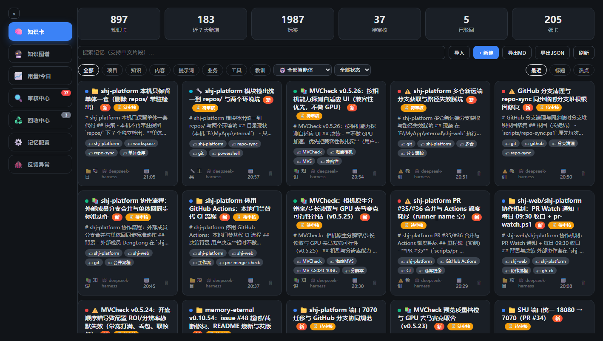
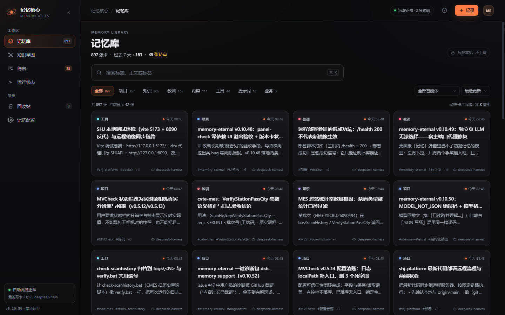
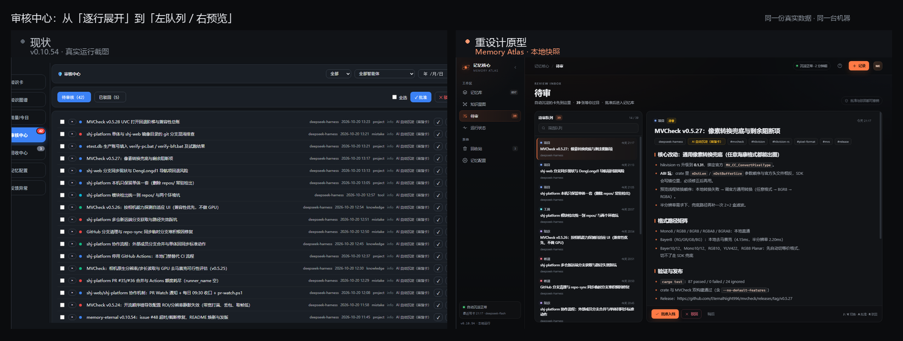
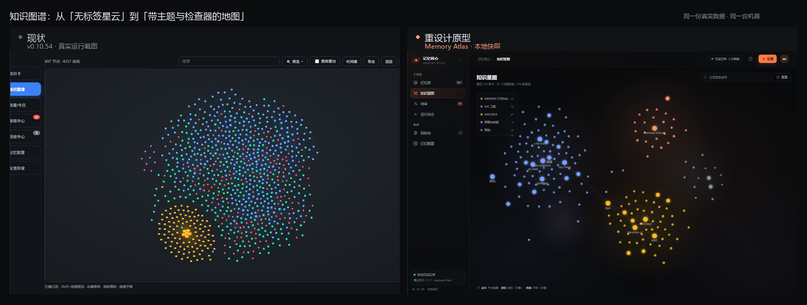
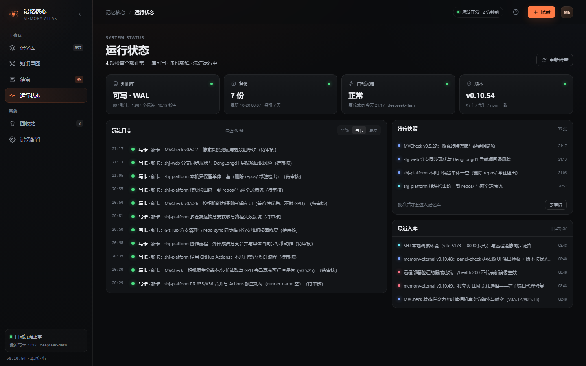
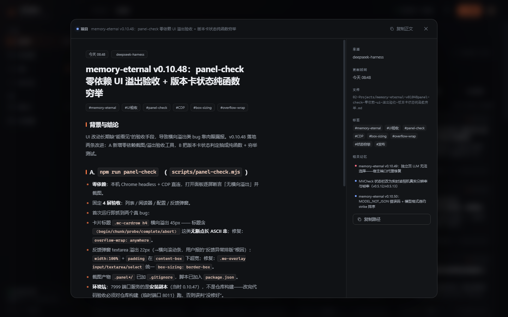
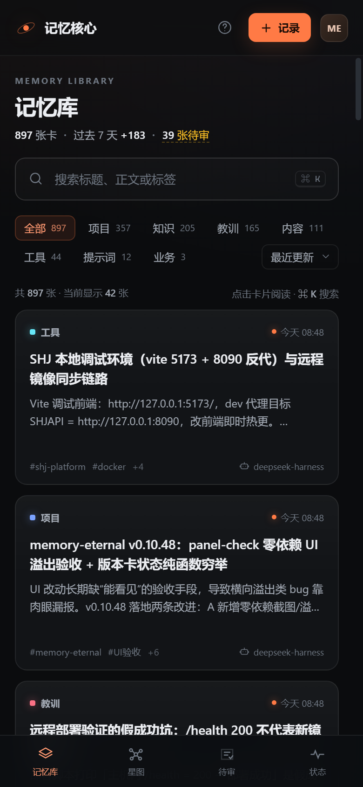

# 记忆核心 · 体验与 UI 全面诊断

> 对象：memory-eternal v0.10.54（DeepSeek Harness 插件，独立 Web UI + DSH 设置页）
> 时间：2026-10-20 晚（真实运行态，写入仍在增长）
> 数据：897 张知识卡 / 1,987 个标签 / 约 40 张待审（审计时 39） / 5 张已驳回 / 3 张回收站
> 方法：在 7999 端口运行真实实例，用 Chrome CDP 在 1440、1024、390 三档视口截图并量化字体、点击目标、对比度、焦点与溢出；对 160 张真实卡片做摘要质量统计；用近似同一时刻的数据快照做出可交互重设计原型。
>
> 后续：记忆库卡片专项升级（87 到 92+）见 [V3-CARD-UPGRADE.md](V3-CARD-UPGRADE.md)；可交互星图与内容抽取见 [V4-GRAPH-CONTENT.md](V4-GRAPH-CONTENT.md)。

---

## 0. 一句话结论

**能，而且不需要推翻功能。** 当前产品最缺的不是"更花哨的皮肤"，而是三件事：

1. **内容层没有清洗**：96% 的卡片摘要把原始 Markdown 标题直接透传上屏，卡片像草稿而不是记忆。
2. **最高频的工作流没有为"判断"设计**：约 40 张待审卡，每行 10px、默认折叠、没有预览栏、没有键盘、没有撤销。
3. **视觉语言没有收口**：emoji 图标、10px 正文、6 个等权 KPI、硬编码颜色，让界面停在"能用的管理后台"。

如果只做三件事：**清洗摘要、审核分栏、统一视觉 token 与图标**。P0 大约 1 到 2 天，第一印象就会有明显变化。

自评（10 分制，主观但基于下方证据）：

| 维度 | 现状 | 目标 |
| --- | --- | --- |
| 功能完整度 | 9.0 | 9.0 |
| 信息架构 | 6.0 | 8.5 |
| 视觉一致性 | 6.0 | 8.5 |
| 可读性 | 5.0 | 8.0 |
| 决策效率 | 4.0 | 8.0 |
| 状态与反馈 | 6.0 | 8.5 |
| 移动端 | 3.0 | 7.0 |
| 第一印象 | 6.0 | 8.5 |

---

## 1. 现状做对了什么

先说不该丢的东西，这决定了重设计是"演进"而不是"换产品"：

- **真实工作流完整**：记忆库、审核、回收、健康、版本对齐、图谱、冲突整理，功能深度在同类插件里很少见。
- **本地与隐私**：数据只在本机，无网络依赖，这是最强的差异化卖点。
- **性能意识**：卡片按需加载、图谱懒挂载、图谱用 Canvas 而非 DOM，860 多节点仍可交互。
- **阅读体验已经有基础**：读卡器支持 j/k 翻页、阅读宽度、进度条、复制正文与路径。
- **视觉验收机制**：`panel-check` 用 CDP 检查白屏、JS 异常和横向溢出，这在个人项目里非常成熟。
- **深色主题方向正确**：深色底、低饱和卡片，适合长时间阅读与开发者工具场景。

下面的问题都建立在"保留这些能力"的前提下。

---

## 2. 七个结构性问题（按影响排序）

### 2.1 内容层：原始 Markdown 直接上屏

这是**单点影响最大**的问题。

对最近 160 张卡的真实统计：

| 指标 | 数量 | 占比 |
| --- | --- | --- |
| 摘要以 `#` 标题开头 | 154 | 96.3% |
| 摘要里含 Markdown 标题标记 | 154 | 96.3% |
| 摘要开头重复卡片标题 | 88 | 55.0% |

真实卡片在列表里显示成：

```text
# shj-platform 本机只保留单体一套代码

## 决策
- 本机不再常驻保留 repos/ 下 7 个独立检出...
```

摘要生成逻辑在 `lib/vault.js` 里是 `body.trim().slice(0, 200)`，所以 frontmatter 后面的 `# 标题`、`## 小节`、反引号、列表符号原样进入摘要。读卡器还会再显示一遍正文里的 H1，造成"标题出现两次"。

**为什么影响吸引力**：用户第一眼看到的不是"我记住了什么"，而是"一段没排版的对话残留"。这会直接降低对产品可靠性的判断。

**建议**：在摘要生成处做 `summarizeCard()`：

- 去 frontmatter；
- 去掉所有标题行、代码围栏、表格行；
- 去掉与 title 重复的首行；
- 取第一段有效文字，压到 80 到 120 字；
- 读卡器跳过正文第一个 H1；
- 保留"查看原文"入口。

这是 CSS 改不出来的质感，必须先做。

---

### 2.2 首屏：6 个等权 KPI 没有故事

现状首屏是 6 个同样大小的数字卡：

```text
897 知识卡 / 183 近 7 天新增 / 1987 标签 / 约 40 待审核 / 5 已驳回 / 205 张卡
```

问题有三层：

1. **语义重复**："知识卡 897" 和 "张卡 205" 看起来像同一类数字，实际上后者是 `byKind.knowledge`，标签写成"张卡"更像笔误。
2. **权重错误**：待审约 40 张是"要我做决定"，却和标签总数一样大；驳回是低频数据，占了一整格。
3. **没有上下文**：897 是多是少？+183 是快是慢？用户需要自己算。

**建议**：首屏只留一句数据故事加三个数字，例如：

> 897 张记忆卡，过去 7 天 +183，约 40 张待审。

待审进入主行动，驳回移到"回收与审核"页。分类计数直接做进筛选 chips（项目 357、知识 205、教训 165...），不再单占一排卡片。

---

### 2.3 审核中心：最高频的决策，最费劲的界面

约 40 张待审，当前界面是"长表格 + 每行一个展开箭头"：

- 行高 10px 字号，来源、时间、kind、severity、reason 全挤在一行；
- 默认折叠，必须点箭头才能读正文；
- 没有右侧预览，没有键盘导航，没有批量撤销；
- 删除用 `window.confirm`，批准后没有 undo；
- 每行标题最多一行，长标题直接省略。

这意味着用户在做"读正文、判断、批准"的高频动作时，需要经过"点开、滚动、再点下一个"的重复劳动。**这是体验损失最大的工作流，也是最能体现产品专业度的地方。**

**建议**：改成左右分栏。

- 左栏 356px：待审队列，kind 圆点、标题两行、来源与时间；
- 右栏：完整正文预览、标签、沉淀原因、批准/驳回/稍后；
- 键盘：J/K 切换、A 批准、R 驳回；
- 操作后底部 toast 提供撤销；
- 顶部保留批量模式与"全选当前筛选结果"。

原型里这个界面已经跑通（见 `shots/prototype-audit.png`），从"逐行展开"变成"左队列右预览"。

---

### 2.4 视觉语言：emoji、10px 与 17px 删除按钮

量化结果（1440 宽、100 张卡片）：

| 指标 | 现状 | 说明 |
| --- | --- | --- |
| 10px 文本 | 600 处 | 卡片标签、footer、badge 大量使用 |
| 10.5px 文本 | 100 处 | 次级元信息 |
| 小于 32px 的点击目标 | 520 个 | 标签 18px 高、删除按钮 17px 高 |
| 卡片 footer 高度 | 29px | 10px 文本被挤成两行，出现"项 / 目"竖排 |
| 卡片摘要字号 | 11.5 到 12px | 长文可读性偏弱 |
| focus 样式 | 无自定义，UA 黑色 1px | 深色背景上几乎不可见 |
| 浅色模式 footer 对比度 | 3.51:1 | 低于 WCAG AA 4.5:1 |

另外：

- 侧栏 7 个入口全部用 emoji（🧠 🔮 📈 🔍 ♻️ ⚙️ 🐞），与深色技术界面不统一，且不同系统渲染差异大；
- 卡片标题前的 kind 圆点与 emoji 重复，信息冗余；
- 每张已审核卡片都挂 "✅ 已审核" 徽章，800 多张卡里 95% 是已审核，徽章没有信息量，只增加噪音；
- 硬编码色值 scattered（`#3b82f6`、`#f59e0b`、`#10b981`、`#ef4444`），浅色模式与深色模式没有统一 token。

**建议**：

- 用一套 1.65 到 1.7 描边的 SVG 图标替换 emoji；
- 字号下限 11.5px，正文 12 到 13px，标题 14.5 到 15px；
- 点击目标最小 28px，标签可点击区域用 padding 扩大；
- 状态徽章只显示非 approved（待审、驳回），已审核不显示；
- footer 单行：`#tag #tag +N   来源`；
- 全局 `:focus-visible { outline: 2px solid var(--ember); outline-offset: 2px; }`；
- 引入一层 CSS token：颜色、字号、间距、圆角、阴影，浅色与深色各自映射。

---

### 2.5 状态、空态与反馈：很多"系统状态"没有状态感

现状"用量/今日"页面实际包含：健康概览、版本对齐、自动沉淀日志、Agent 自动沉淀的卡。名字叫"用量"，内容却是"运行状态"。

具体问题：

- 健康概览用 `✅` emoji 当状态图标，失败/成功没有统一的视觉语言；
- 加载只有一行"加载中…"，没有骨架；
- 搜索无结果时，页面仍然显示"记忆库还是空的，多聊几轮后…"，把"没搜到"误判成"库是空的"；
- 删除、批量等破坏性操作使用原生 `window.confirm`，与整体视觉断裂；
- 批准/驳回后没有撤销；
- 版本、备份、沉淀、库可写性这些"信任信号"埋在长文本里，第一眼看不到。

**建议**：

- 把页面改名为"运行状态"，顶部 4 张状态卡：知识库、备份、自动沉淀、版本；
- 下面是沉淀时间线（写卡/跳过/启动），右侧是待审快照与最近入库；
- 状态用圆点加颜色，不用 emoji；
- 搜索无结果用独立空态：插图、清楚说明、清除筛选/记录一张；
- 加载用与卡片同形的骨架；
- 所有破坏性操作改为应用内确认 + 撤销 snackbar。

---

### 2.6 知识图谱：第一眼好看，第二眼读不懂

现状图谱有 897 个节点、4257 条连线，视觉密度很震撼，但：

- 没有常驻标签，需要缩放才出现；
- 没有星团/主题语义，用户不知道那一团是什么；
- 图例藏在"筛选"下拉里；
- 点击节点没有侧栏检查器，只有右键菜单；
- 没有搜索命中后的高亮路径；
- 第一印象更像"屏保"，而不是"我的知识地图"。

**建议**：保留 Canvas 性能，在其上叠加"可读层"：

- 力导向布局按主题/标签收敛成 5 到 8 个星团；
- 12 个高频标签常驻显示，其余 hover 显示；
- 顶部搜索高亮并聚焦到命中节点；
- 点击节点打开右侧检查器：标题、摘要、标签、来源、相关卡；
- 图例常驻左侧，显示每个主题的卡数；
- 首次进入给一句解释："节点是卡，连线是共享标签"。

原型里用最近 160 张卡演示了"主题星团 + 标签避让 + 节点检查器"的效果；生产版保留 897 节点的 Canvas，只叠加同样的可读层与检查器。

---

### 2.7 移动端：不是响应式，是"桌面缩小"

390px 实测：

- 侧栏 150px 常开，占掉 38% 宽度；
- 6 个 KPI 卡纵向堆叠，首屏看不到一张记忆卡；
- 工具栏横向溢出 15px；
- 520 个点击目标小于 32px；
- 卡片 footer 继续换行。

**建议**：

- 小于 900px 隐藏侧栏，改底部 4 个 tab（记忆库 / 星图 / 待审 / 状态）；
- 页面头部纵向堆叠，隐藏信任 chip；
- 6 个 KPI 改为横向可滚动的 3 个数字，或直接收进筛选 chips；
- 卡片单列，操作按钮 36px 以上。

---

## 3. 量化基线表

| 指标 | 现状 | 目标 | 验证方式 |
| --- | --- | --- | --- |
| 摘要含原始 Markdown | 154 / 160 | 0 | 单测 + 抽样 |
| 摘要重复标题 | 88 / 160 | 0 | 单测 |
| 首屏等权 KPI 卡 | 6 | 0 到 3 | 截图 |
| 10px 文本 | 600 处 | 0 | CDP 统计 |
| 点击目标 < 32px | 520 个 | 0 | CDP 统计 |
| 卡片 footer 高度 | 29px（两行） | 16px（单行） | CDP |
| 自定义 focus 样式 | 无 | 2px ember | 键盘截图 |
| 浅色 footer 对比度 | 3.51:1 | ≥ 4.5:1 | 对比度脚本 |
| 移动端横向溢出 | 15px | 0 | panel-check |
| 审核正文预览 | 需逐行展开 | 默认右栏 | 截图 |
| 图谱常驻标签 | 缩放后才出现 | 12 个 | 截图 |
| 搜索无结果 | 误报"库是空的" | 专属空态 | 交互截图 |

---

## 4. 设计方向：Memory Atlas / 记忆星图

### 4.1 设计读法

> 面向使用 AI 做长期项目开发的知识工作者，一个本地、私密、会生长的第二大脑；视觉上要"档案感 + 星图 + 工作台"，不要"AI 紫色渐变仪表盘"。

三个关键词：

- **档案（Archive）**：深色、纸感、编号、时间线，让记忆有"被保存"的重量。
- **星图（Constellation）**：节点、连线、主题星团，让知识有"在生长"的感觉。
- **工作台（Workbench）**：搜索、筛选、阅读、批准，所有高频动作一屏可达。

### 4.2 五条原则

1. **内容优先**：chrome 退后，标题、摘要、正文是主角。
2. **每屏一个焦点**：记忆库是"搜索并阅读"，待审是"读并决定"，星图是"探索"。
3. **品牌色只做焦点**：余烬橙 `#FF7A45` 只用于主按钮、当前导航、新卡点、焦点环；状态色只表达状态。
4. **数字有上下文**：每个数字都有单位、时间范围或可点击的去处。
5. **所有状态可见**：加载骨架、空态、错误、撤销，一个都不能少。

### 4.3 视觉 token（原型采用）

| 类别 | 取值 |
| --- | --- |
| 背景 | `#0B0C0E` / 表面 `#121417` / 浮层 `#181B20` |
| 文本 | 主 `#ECEEF2` / 次 `#A3AAB4` / 弱 `#6F7782` |
| 品牌 | Ember `#FF7A45`，柔光 `rgba(255,122,69,.10)` |
| 状态 | 通过 `#4ADE80` / 待审 `#FBBF24` / 驳回 `#FB7185` |
| 字体 | Inter / Segoe UI / PingFang SC / Microsoft YaHei 系统栈 |
| 字号 | 9.5 标签、11.5 次级、12 摘要、13 正文、15 卡标题、27 页面标题 |
| 圆角 | 7 控件、9 按钮、13 卡片、17 浮层 |
| 间距 | 4 的倍数，卡片内 14 到 16 |
| 动效 | 140 到 220ms，ease-out；hover 抬升 2px；尊重 reduce-motion |

### 4.4 四个核心界面

**记忆库**

- 一句数据故事 + 大搜索（⌘K）+ 分类 chips（带计数）；
- 卡片只显示待审/驳回状态，摘要清洗，标签最多 2 个加 +N，footer 单行；
- 空态是星座插图加"清除筛选/记录一张"。





**待审**

- 左队列右预览，正文默认可读；
- A 批准、R 驳回、J/K 切换、撤销；
- 操作栏固定在底部，理由与标签在标题下方。



**知识星图**

- 主题星团 + 12 个常驻标签 + 标签避让；
- 搜索、图例、节点检查器；
- hover 提示，点击打开相关卡。



**运行状态**

- 4 张状态卡：知识库、备份、自动沉淀、版本；
- 沉淀时间线：写卡/跳过/启动；
- 右侧待审快照与最近入库；
- 没有 emoji 对勾，只有状态圆点。



**阅读器**

- 正文加右侧元信息栏：来源、更新时间、文件、标签、相关记忆；
- 顶部阅读进度，复制正文/路径；
- 长文阅读宽度 70ch，标题 25px。



**移动端**

- 侧栏改为底部 4 tab；
- 头部纵向堆叠；
- 卡片单列，操作区足够大。



---

## 5. 可交互原型

- 文件：`preview/memory-atlas.html`（本地打开即可）
- 数据：`preview/data.js` 由 `preview/snapshot.mjs` 从本机 API 生成，含真实记忆内容，**已被 `/preview/*` 的 gitignore 排除，不要提交**
- 重新生成：`node preview/snapshot.mjs`
- 截图：`node preview/shoot.mjs`
- 对比图：`python preview/compare.py`

原型支持：

- 侧栏切换四个视图；
- ⌘K 或 / 聚焦搜索；
- 卡片打开阅读器，Esc 关闭；
- 待审：J/K 切换、A 批准、R 驳回、撤销；
- 星图：hover 提示、点击检查器、图例筛选、搜索；
- 运行状态：写卡/跳过筛选；
- 移动端底部导航。

说明：原型星图使用最近 160 张卡生成，目的是演示可读性；生产版应保留现有 897 节点 Canvas，只叠加主题与检查器。

---

## 6. 三阶段路线图

### P0：1 到 2 天，立刻可感知（建议先做）

| # | 动作 | 影响 | 风险 |
| --- | --- | --- | --- |
| 1 | 摘要清洗 + 读卡器跳过重复 H1 | 最大，直接改变第一眼 | 低，纯展示层 |
| 2 | 卡片 footer 单行、标签限 2 加 +N、字号下限 11.5 | 高 | 低 |
| 3 | 已审核徽章不再显示，只显示待审/驳回 | 高，降噪 | 低 |
| 4 | 自定义 focus-visible、卡片可 Tab、Enter 打开 | 中高，无障碍 | 低 |
| 5 | 搜索无结果空态、清空按钮、结果数 | 中 | 低 |
| 6 | 移动端三条 CSS：隐藏侧栏、头部堆叠、stats 横滚 | 中高 | 低 |
| 7 | 移除"张卡"重复 KPI，页面改名"运行状态" | 中，语义 | 低 |

验收：`npm run panel-check` 零溢出；截图前后对比；补充摘要单测。

### P1：1 到 2 周，结构性质变

1. 审核中心左右分栏 + 键盘 + 撤销 + 批量。
2. 运行状态页重排：4 状态卡 + 时间线 + 待审快照。
3. 导航分组（工作区/系统），命令搜索 ⌘K，加载骨架。
4. 阅读器右侧元信息 + 相关记忆 + 目录。
5. 统一 SVG 图标，抽 CSS token（字号/间距/颜色/圆角）。

验收：审核时间实测；键盘全流程；浅色/深色截图；a11y 对比度。

### P2：2 到 4 周，形成"签名"

1. **记忆日报**：今天新增几张、哪几个主题在生长、哪张卡被反复召回。
2. **星图主题聚类**：社区检测 + 星团标签 + hover 卡片预览。
3. **快速记录 / 模板**：从"自动沉淀"扩展到"主动记一笔"。
4. **对外演示资产**：30 秒 GIF、README 首屏、脱敏在线 Demo。

---

## 7. 预期收益

- **第一印象**：从"一个功能很多的插件"变成"一个有记忆感的产品"；截图和 GIF 更愿意被点开。
- **审核效率**：约 40 张待审，从逐行展开的 5 到 8 分钟，降到分栏加键盘的 2 到 3 分钟（需实测）。
- **检索效率**：搜索有结果数、空态和清空动作，减少"是不是坏了"的疑问。
- **信任**：库、备份、沉淀、版本四个状态一眼可见，降低"静默失败"的焦虑。
- **可维护性**：token 化后，浅色/深色、字号、圆角不再散落在内联样式里。
- **移动端**：从"不能看"到"能读完一张卡再批"。

### 风险与边界

- 现有 60 多个测试文件里有大量源码守卫测试，P0 改动应尽量只动展示层，改完跑全量测试。
- 共享 CSS 类（`.mc-*`、`.me-dialog-*`）在设置页、弹窗、独立页三处复用，改前先列使用者。
- 星图 897 节点的性能不能退化，新增标签/检查器要用 Canvas 绘制或 LOD。
- 不建议一次性重写整个 `src/client/index.tsx`；按 P0、P1 小步走，每步用 `panel-check` 截图验收。

---

## 8. 结论

**能做得更有吸引力，而且现有功能是资产，不是包袱。**

真正的吸引力来自三件事，按优先级：

1. **把内容变干净**：摘要清洗、去掉重复标题、降低噪音徽章。
2. **把决策变快**：审核分栏、键盘、撤销。
3. **给产品一个签名时刻**：星图主题化、记忆日报、可信的运行状态。

这三件事都不需要改变数据结构和 API，风险可控，收益直接体现在第一眼和每天最高频的操作上。

下一步建议：先做 P0 的 1 到 3 项，预计半天内就能看到卡片列表的质变；确认方向后再做 P1 的审核分栏与状态页。

---

### 附：截图索引

| 文件 | 内容 |
| --- | --- |
| `shots/current-library.png` | 现状记忆库 |
| `shots/prototype-library.png` | 重设计记忆库 |
| `shots/current-audit.png` | 现状审核中心 |
| `shots/prototype-audit.png` | 重设计待审 |
| `shots/current-graph.png` | 现状知识图谱 |
| `shots/prototype-graph.png` | 重设计知识星图 |
| `shots/prototype-status.png` | 重设计运行状态 |
| `shots/prototype-reader.png` | 重设计阅读器 |
| `shots/prototype-mobile.png` | 重设计移动端 |
| `shots/compare-library.png` | 记忆库前后对比 |
| `shots/compare-audit.png` | 审核前后对比 |
| `shots/compare-graph.png` | 图谱前后对比 |
| `shots/prototype-overview.png` | 四屏总览 |
