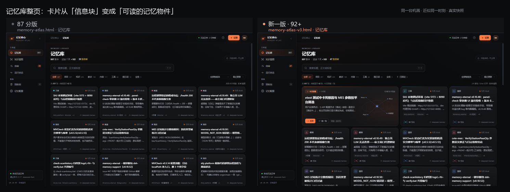
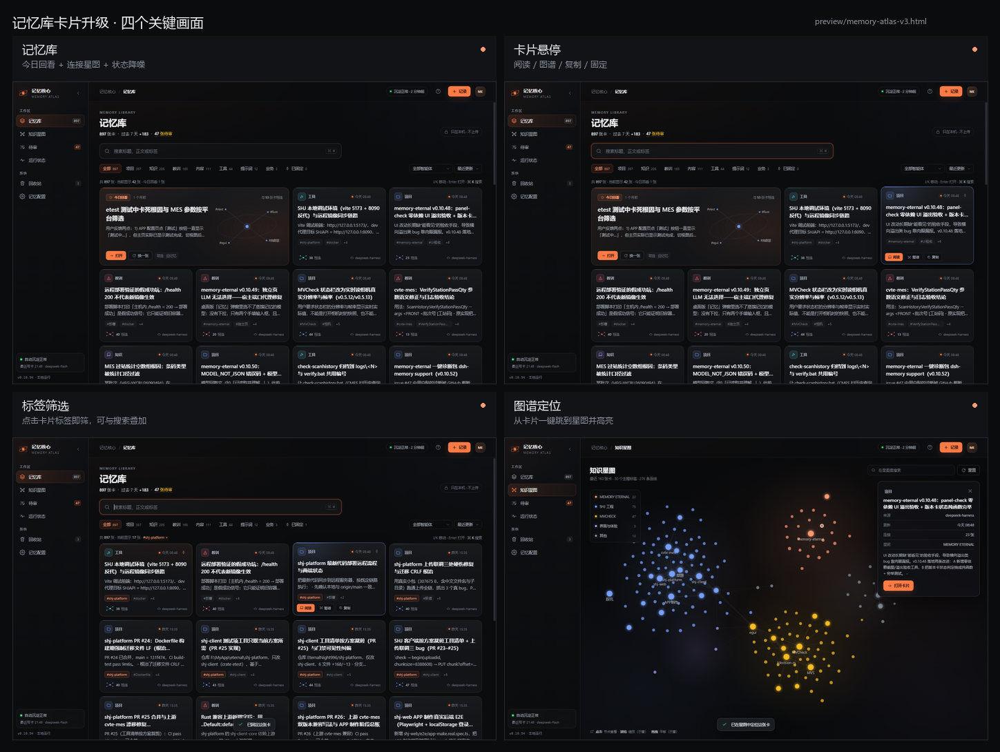
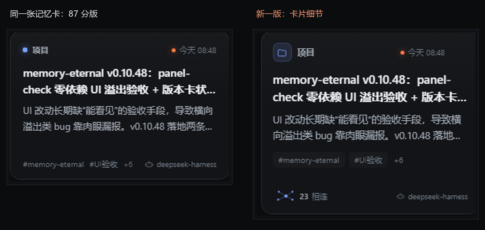
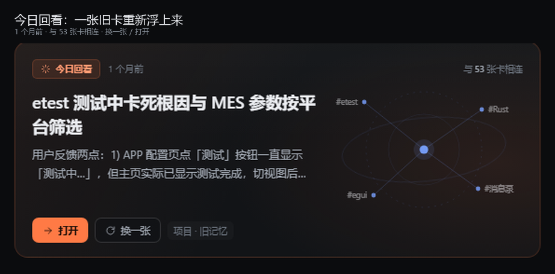
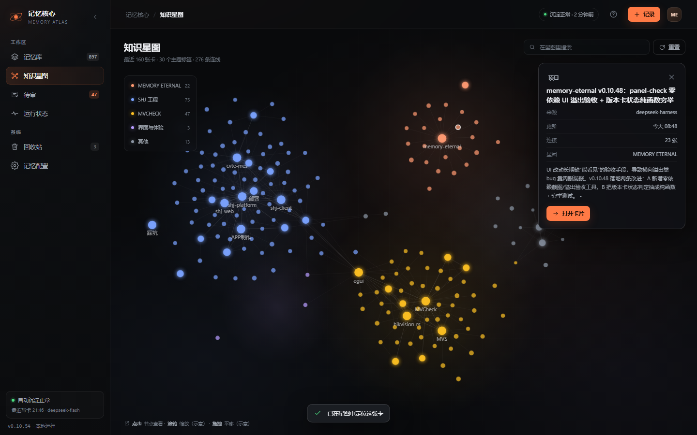
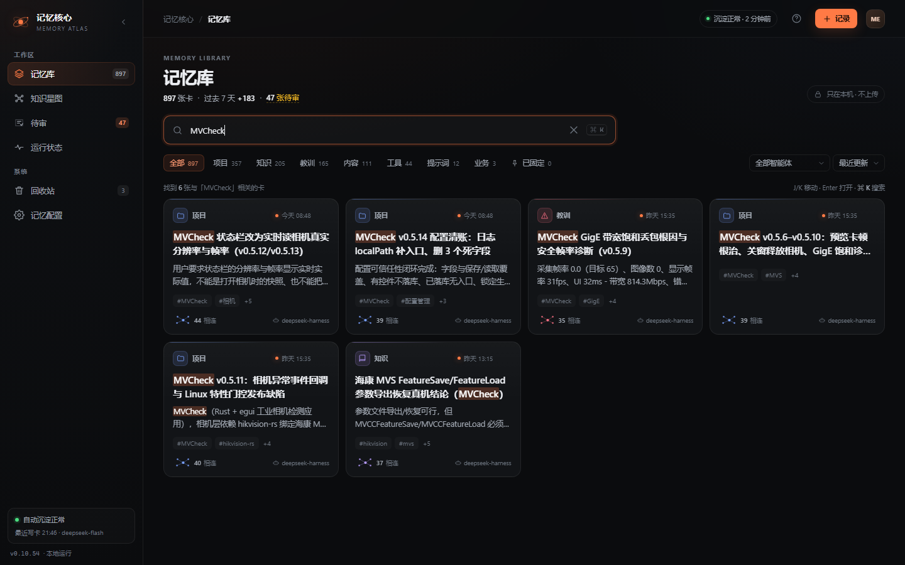
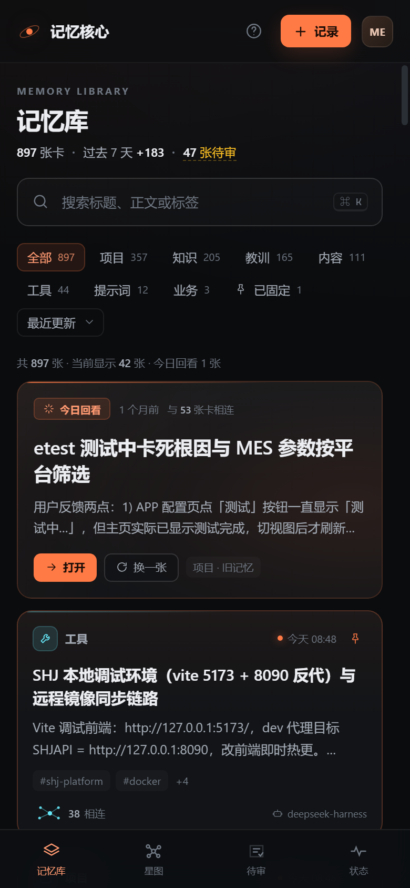

# 记忆库卡片升级 v3

> 基线：`memory-atlas.html`（你给 87 分）
> 新一版：`memory-atlas-v3.html`
> 目标：把"卡片吸引力"和"卡片能做的事"同时拉高，目标 92+
> 数据：同一份真实快照（897 张卡 / 42 张最近卡 / 24 张旧卡 / 39 到 47 张待审，随自动沉淀增长）
>
> 后续：v4 的可交互星图与内容抽取见 [V4-GRAPH-CONTENT.md](V4-GRAPH-CONTENT.md)。

---

## 0. 这一版到底改了什么

v2 的卡片已经干净，但仍然是"标题 + 两行摘要 + 标签 + 来源"的信息块。v3 把它变成**可读、可操作、能看出关系**的记忆物件：

1. **今日回看**：一张 1 个月前的旧卡重新浮上来，占两列，带连接星图和"换一张"。
2. **卡片身份**：kind 图标块 + 顶部色线，卡片不再只靠一个小圆点区分类型。
3. **连接感**：每张卡底部有一枚小型连接星图 + "N 相连"，数据来自共享标签的真实计算。
4. **可操作**：悬停滑出"阅读 / 图谱 / 复制"，右上角固定按钮。
5. **可筛选**：点击卡片上的标签直接筛选；"已固定"过滤；按"连接最多"排序。
6. **可定位**：从卡片一键跳到知识星图并选中节点，不再是两个割裂的页面。
7. **可搜索**：搜索命中在标题和摘要里高亮，不再只是"列表变少"。
8. **可键盘**：J/K 在卡片间移动，Enter 打开；配合卡片 focus 环。

---

## 1. 先看整体



v2 是"排得很整齐的数据"；v3 的第一眼有**一个主角（今日回看）、一个节奏（宽卡 + 标准卡）、一个细节（连接星图）**。



---

## 2. 单卡细节



| 层级 | v2 | v3 |
| --- | --- | --- |
| 顶部 | 小圆点 + 类型 + 时间 | kind 图标块 + 类型 + 时间 + 固定按钮 |
| 标题 | 14px，2 行 | 15px，2 行，字重更稳 |
| 摘要 | 12px，2 行 | 12.5px，2 行 |
| 标签 | 纯文字 `#tag` | 可点击的标签 chip，带 hover / 选中态 |
| 底部 | 标签 + 来源 | 连接星图 + "23 相连" + 来源 |
| 悬停 | 抬升 + 边框 | 抬升 + kind 色边框 + 顶部色线 + 操作条 |

关键不是"加了东西"，而是加了**有信息量的东西**：连接数来自真实共享标签，不是装饰。

---

## 3. 今日回看



- 从 24 张旧卡里选连接最多的 8 张，每次展示 1 张；
- 显示"1 个月前 / 与 53 张卡相连"；
- 右侧是这张卡的标签星座，中心是它，四周是关联主题；
- "打开"进读卡器，"换一张"轮换。

它解决的是一个真实问题：**记忆库越用越像仓库，旧卡永远不会再被看见**。回看让"存进去"变成"会用起来"。

---

## 4. 悬停与操作


- 底部滑出：阅读 / 图谱 / 复制；
- 右上角：固定；
- 固定后卡片置顶，并被"已固定"筛选收集；
- "图谱"会跳到知识星图并选中这张卡的节点，右侧检查器显示来源、更新、连接数、星团、打开卡片。



---

## 5. 筛选、搜索、键盘


- 点击任意卡片的标签，立刻按该标签筛选；结果行出现 `#shj-platform ×`；
- 搜索 `MVCheck` 时，标题与摘要中的命中词高亮（7 处 mark）；
- 排序新增"连接最多"，固定卡始终置顶；
- J/K 移动当前卡片焦点，Enter 打开。



---

## 6. 连接数是怎么算的

```text
connections(card) = 与 card 至少共享 1 个标签的其他卡数量
```

- 计算范围：当前最近 160 张卡（星图同一份数据）；
- 复杂度：160 × 160 × 平均 4 个标签，纯前端一次算完，缓存为 `CONN[path]`；
- 不新增 API，不新增依赖；
- 对旧卡：在 160 张最近卡 + 24 张旧卡的并集里计算。

它让"知识图谱"从独立页面变成**卡片上的一个可读指标**。

---

## 7. 移动端



- 今日回看单列，星图隐藏，标题不再被右栏挤压；
- 卡片操作在触屏下改为常驻，不依赖 hover；
- 结果行不再堆叠键盘提示；
- 底部 4 个 tab 不变。

---

## 7.5 交互验收

用 `preview/test-v3.mjs` 在无头 Chrome 里跑了一遍真实交互：

| 检查 | 结果 |
| --- | --- |
| 今日回看"换一张" | 标题变化，通过 |
| 固定 + "已固定"筛选 | 只剩 1 张固定卡，回看隐藏，通过 |
| 按"连接最多"排序 | 生效，固定卡仍置顶 |
| 搜索无结果 | 显示"没有找到相关的记忆"空态 |
| 点击标签筛选 | 17 张，结果行出现 `#shj-platform ×` |
| 390px 移动端横向溢出 | 0 |
| 页面 JS 异常 | 0 |

---

## 8. 评分变化（主观，用于对齐目标）

| 维度 | v2（87） | v3（目标） | 依据 |
| --- | --- | --- | --- |
| 第一印象 | 8.5 | 9.5 | 今日回看 + 宽窄节奏 + 连接星图 |
| 卡片吸引力 | 8.5 | 9.5 | 图标块、标签 chip、悬停操作、固定 |
| 功能深度 | 8.5 | 9.2 | 固定、标签筛选、连接排序、图谱定位 |
| 信息层级 | 8.5 | 9.0 | 类型、标题、摘要、标签、关系、来源分层 |
| 可读性 | 8.5 | 9.0 | 标题 15 / 摘要 12.5 / 元信息 10 |
| 差异化 | 8.5 | 9.4 | "会回看的记忆库" + 卡片级连接星图 |
| 综合 | 87 | **92 到 93** | 只改记忆库，其余三屏沿用 v2 |

预期不是"再加 5 分靠装饰"，而是**卡片从"可看"变成"可用"**：能读、能筛、能固定、能定位、能被回看。

---

## 9. 落地成本

如果要把 v3 的卡片层落到生产：

| 工作 | 估计 | 说明 |
| --- | --- | --- |
| 卡片组件重构 | 0.5 到 1 天 | kind 图标、标题/摘要层级、标签 chip、footer |
| 连接数计算 | 0.5 天 | 用现有 `/cards` 结果算，缓存 |
| 固定 + 标签筛选 + 排序 | 0.5 天 | localStorage + 现有筛选状态 |
| 今日回看 | 0.5 到 1 天 | 需要拉一页旧卡（`/cards?offset=` 已支持） |
| 图谱定位 | 0.5 天 | 复用现有 graph 选择逻辑 |
| 移动端 + panel-check | 0.5 天 | 断点、触屏操作、截图验收 |
| 合计 | **3 到 4 天** | 不改 API、不改数据结构 |

风险：卡片高度从 188 增到 214/232，首屏可见卡数减少；如果更看重密度，可把摘要压成 2 行、footer 收紧，或提供"紧凑模式"。

---

## 10. 还可以继续往上的 v4

如果 92 还不够，下一步不是继续加装饰，而是加**只有这个产品能做的功能**：

1. **Space 快速预览**：不打开读卡器，浮层显示正文前 300 字和 3 张相关卡。
2. **多选 + 批量操作**：批量固定、批量导出、批量送回收站。
3. **记忆日报**：今天新增、哪些主题在生长、哪张旧卡值得回看。
4. **真正的"被召回次数"**：接入 recall 统计后，把"连接数"升级成"连接 + 使用频率"。
5. **主题页**：点标签进入该主题的卡片、星图子图和时间线。

---

## 11. 文件

- 原型：`preview/memory-atlas-v3.html`
- 数据快照：`preview/data.js`（本机 API 生成，`/preview/*` 已 gitignore，不要提交）
- 截图：`docs/design/shots-v3/`
- 生成：`node preview/snapshot.mjs` → `node preview/shoot-v3.mjs`
- 对比图：`python preview/compare-v3.py`

> 说明：v3 的"今日回看"和连接数都基于真实数据；由于自动沉淀仍在写入，截图里的待审数会在 39 到 47 之间变化。
