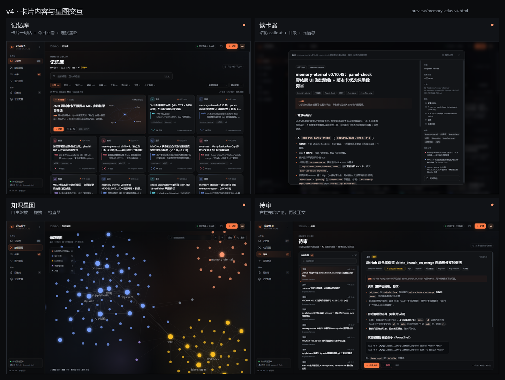
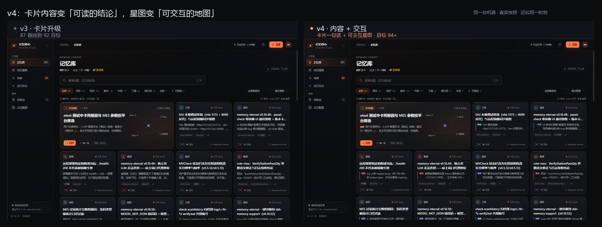
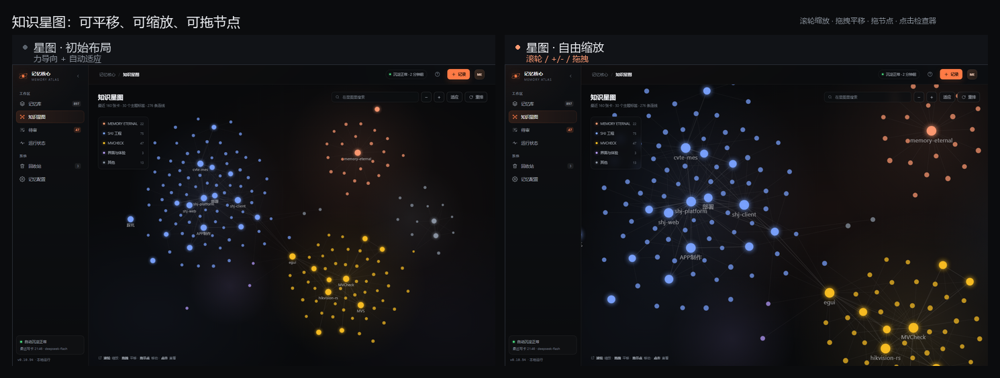
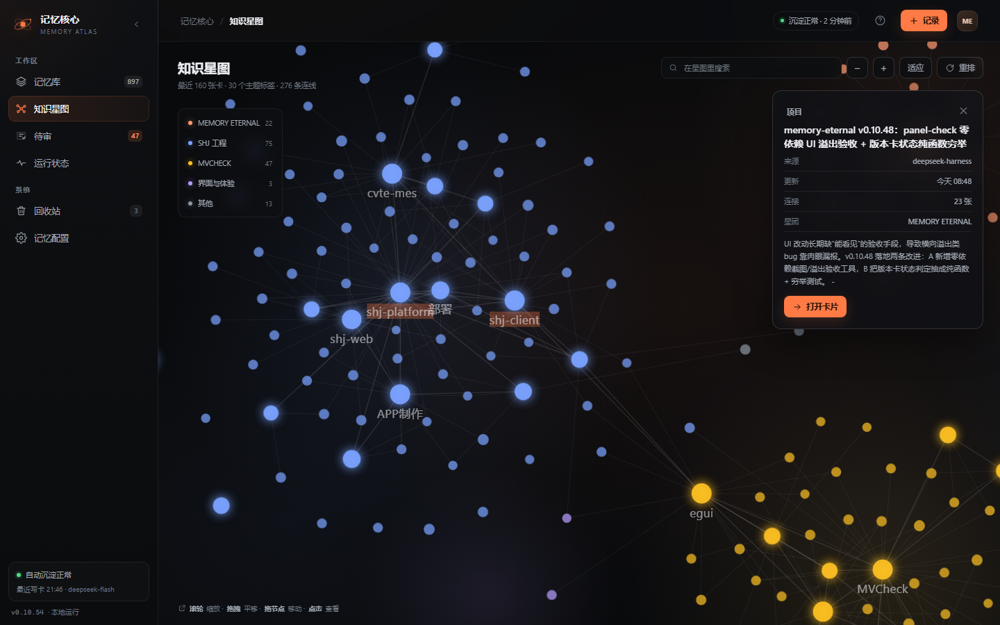
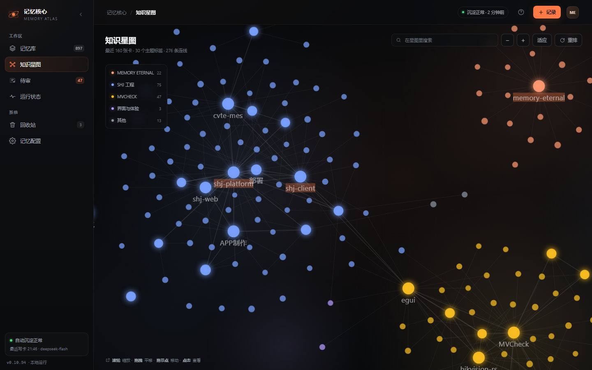
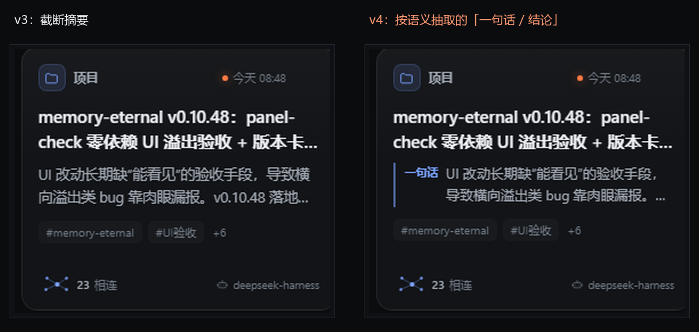
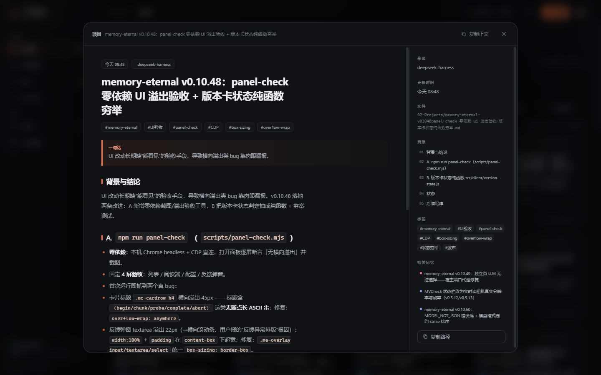
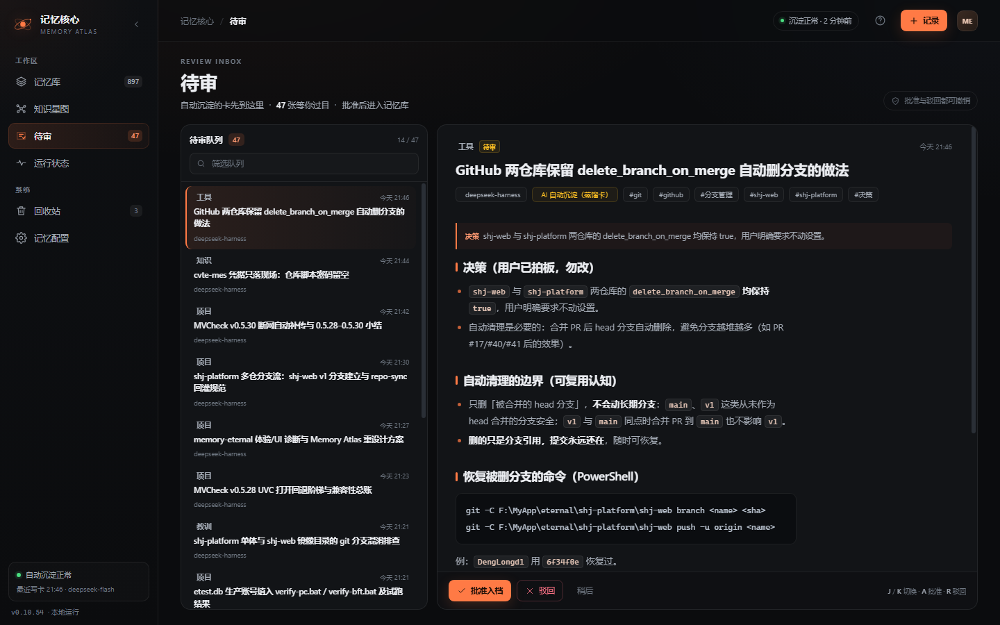

# 知识星图交互 + 内容层升级 v4

> 基线：`memory-atlas-v3.html`
> 新一版：`memory-atlas-v4.html`
> 目标：在 v3 的卡片升级之上，补上可交互星图与内容语义层，目标 94+。
> 回答两个问题：
> 1. 知识图谱会不会动、能不能自由缩放？
> 2. 还能不能做更好的内容？





---

## 1. 先回答：星图现在会动、能缩放、能拖

v3 的星图是**一次性布局 + 静态 SVG**，所以你看到的是"一张画"，不是"一张图"。v4 把它变成了一个可操作的地图：

| 操作 | 行为 |
| --- | --- |
| 滚轮 | 以鼠标为中心自由缩放（0.35x 到 3x） |
| `+` / `−` | 以画布中心缩放 |
| 拖拽空白 | 平移画布 |
| 拖拽节点 | 移动单个节点，连线实时跟随 |
| 适应 | 自动把全部节点装进视口 |
| 重排 | 重新抖动 + 力导向布局，节点会自己飘回去 |
| 点击节点 | 右侧打开检查器 |
| 悬停节点 | 显示标题 / 标签 / 类型 |
| 搜索 | 命中的标签和卡高亮，其余变暗 |
| 图例 | 按主题开关，隐藏不相关星团 |

底层是轻量力导向：190 个节点、276 条连线，节点有斥力、边有弹簧、每个星团有重心；初始布局会自己稳定，结束自动适应视口。`prefers-reduced-motion` 下直接显示稳定布局，不做动画。







说明：生产版的 Canvas 图谱本来就有平移/缩放；这次是把**原型**补齐，并把"主题标签 + 检查器 + 力导向"一起做进来。真机 897 节点版本需要保留 Canvas 的 LOD 与性能策略，不能直接搬 SVG。

---

## 2. 内容层：从"截断摘要"到"按语义抽一句话"

v3 的卡片正文还是 `cleanSummary()` 的截断：能看，但经常把"背景"当摘要，或者把末尾的"踩坑"当成整张卡的主旨。

v4 改成**按章节语义抽取**：

```text
优先章节：结论 / 总结 → 决策 / 选择 → 根因 / 原因 / 定位
        → 教训 / 踩坑 → 核心 / 要点 / 改动 → 结果 / 验证 / 发布
约束：只在前两节里优先（根因允许到第三节）；末尾的"踩坑"不会抢走整张卡的主旨
兜底：没有匹配章节时用第一节或 cleanSummary
```

卡片上会显示一个语义标签：

- **结论**：真正的结论
- **决策**：拍板了什么
- **根因**：为什么
- **教训**：踩了什么坑
- **要点**：环境、配置、用法、流程
- **一句话**："背景与结论"合写时的 TL;DR
- **摘要**：实在没有结构时的兜底



同时修了两个内容质量问题：

1. **不再丢掉下划线**：`delete_branch_on_merge`、`localPath` 这类标识符不会被 `strip` 成 `deletebranchonmerge`。
2. **不再让末尾的"踩坑"冒充主旨**：例如"SHJ 本地调试环境"会抽到"Vite 调试前端…"，而不是后面 scp 传输失败的踩坑。

---

## 3. 读卡器：结论 + 目录



- 标题下先给一条**一句话结论**，读长文前先知道结论；
- 右侧自动生成**目录**（H2/H3），点击平滑滚动；
- 来源、更新时间、文件、标签、相关记忆仍在右栏；
- 正文仍然完整，结论只是"先读这一段"。

这比"从标题直接进正文"更适合知识卡：大部分卡只需要读结论和第一段。

---

## 4. 审核中心：先给判断，再读全文



- 右栏顶部增加一条"决策/根因/教训"式的短判断，批准前先看到"这张卡在说什么"；
- 正文仍然完整，向下滚动即可核对细节；
- 与 v3 的分栏、键盘、撤销保持一致。

---

## 5. 验收

用 `preview/shoot-v4.mjs` 在无头 Chrome 里跑真实交互：

| 检查 | 结果 |
| --- | --- |
| 星图节点数 / 连线数 | 190 / 276 |
| 初始布局后自动适应 | `scale 1.0426` |
| 点击两次放大 | `scale 1.6291`，transform 变化 |
| 滚轮缩放 | `1.0426` 到 `1.6319`，transform 变化 |
| 拖拽平移 | transform 变化 |
| 拖拽节点 | 节点 transform 从 `703,199` 到 `725,209` |
| 点击节点检查器 | 打开成功 |
| 读卡器目录 | 5 个章节 |
| 卡片语义标签 | 抽取成功（结论 / 根因 / 教训 / 要点等） |
| 390px 横向溢出 | 0 |
| JS 异常 | 0 |

---

## 6. 还能怎么继续

内容层下一步不是"再抽一句话"，而是**让内容有证据链**：

1. **结论 + 两条证据 + 反例**：从正文里抽"结论 / 依据 / 边界"，卡片 hover 展开。
2. **LLM 精炼**：只对高价值卡调用本地模型，生成"一句话结论 + 3 个要点"，并保留原文链接；需要 API，成本和延迟要评估。
3. **被召回次数**：接入 recall 统计，卡片显示"被用过 N 次"，比单纯的连接数更接近"记忆价值"。
4. **主题页**：点标签进入该主题的卡片 + 子图 + 时间线。
5. **图谱簇标签**：对每个星团做社区检测，自动命名（当前是 5 个主题 + 30 个标签，足够读，但还不是自动聚类）。
6. **触屏双指缩放**：桌面滚轮/按钮已支持，移动端目前是 +/- 按钮。

---

## 7. 文件

- 原型：`preview/memory-atlas-v4.html`
- 截图：`docs/design/shots-v4/`
- 交互验收：`node preview/shoot-v4.mjs`
- 数据快照：`node preview/snapshot.mjs`
- 说明：v4 仍然只改展示层，不改 API、不改数据结构；图谱交互与内容抽取都可以逐步落到生产。
