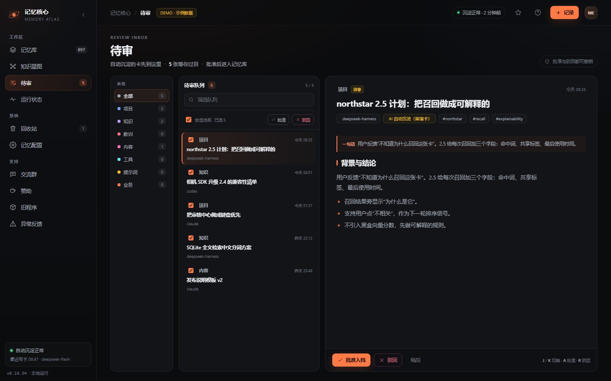
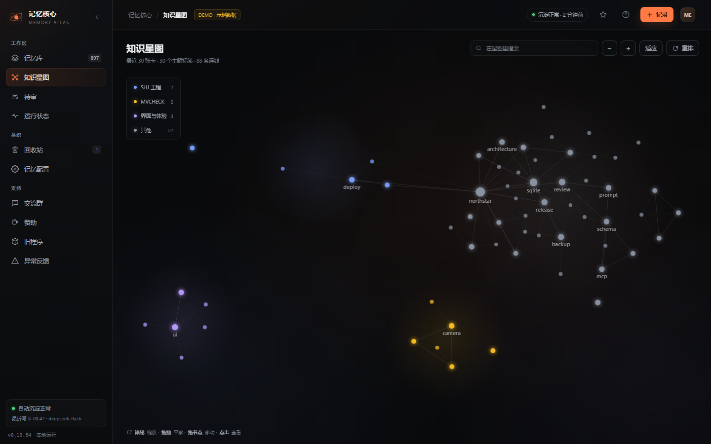
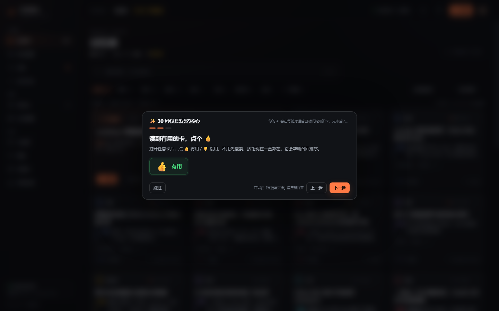
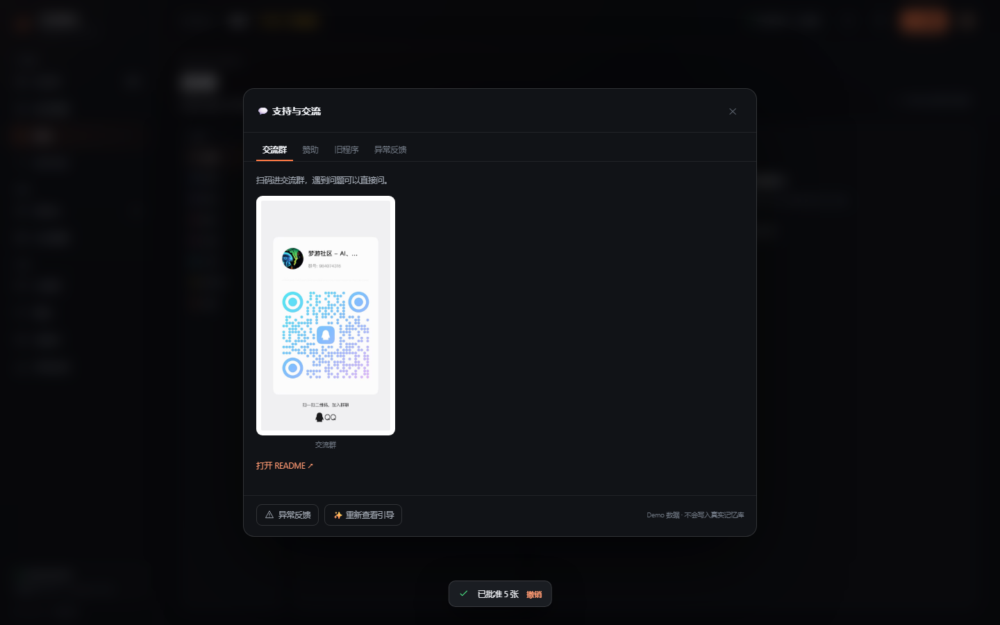

# V5：把三项功能合进新版本

> 目标：不是把功能单独贴在旧界面上，而是让「待审类型 + 批量审批」「星图默认缩小」「首次引导 + 支持入口」成为 Memory Atlas 新版本的一部分。
> 状态：**v0.11.0-rc.1 已把 V5 主题、228px 导航、记忆库卡片网格、审核三栏（类型 / 队列 / 判词预览）、星图默认缩小、首次引导与支持入口落到生产。读卡器右侧目录与相关记忆也已接入；V5 状态页仍可继续收口。公开 Demo 是完整 V5。**

## 1. 待审：三栏 + 类型栏 + 批量审批

- 审核页改为 **顶部类型条 / 待审队列 / 判词预览**，类型筛选不再占用左侧宽度。
- 顶部类型条显示每个类型的实时数量与颜色，点一下只看该类型；宽屏一行，窄屏自动换行。
- 队列每行有勾选框，支持**全选当前筛选结果**，顶部出现「已选 N」。
- 批量批准 / 批量驳回直接作用在勾选卡上，可撤销。
- 每行保留类型徽标，扫一眼就知道是项目、知识、教训还是内容。
- 右侧预览栏跟随选中的卡加载正文，底部直接批准 / 驳回；队列里仍可展开正文。
- 窄弹窗（容器 < 1120px）自动收起预览栏，行内出现 👁 按钮，点开为 **440px 右侧抽屉**；类型栏转为顶部横向条，应用栏收成图标栏，批量按钮转两列。
- 空队列、搜索、单卡批准/驳回、J/K/A/R 快捷键全部保留。

## 2. 记忆库：V5 卡片网格与页头

- 记忆库顶部加 V5 页头：`MEMORY ATLAS / 记忆库 / 你的本地第二大脑`，右侧显示已加载 / 总数。
- 卡片改为 V5 结构：类型徽标 + 新/待审状态 + 时间、两行标题、三行导语、标签、连接数/作者/删除。
- 网格从 230px 提高到 260px 最小列宽，1440 宽度下稳定四列。
- 搜索命中片段、标签筛选、排序、无限滚动、删除全部保留。

## 3. 知识星图：默认视图按数量自适应

- 节点多时默认缩小：**> 120 个节点使用 0.78 倍 fit**，先看全局，减少首屏拥挤。
- 节点少时保持接近铺满（0.94 倍），避免 Demo 看起来空。
- 「适应」按钮仍然按 1.0 铺满；缩放、拖拽、节点拖动、检查器、重排都不变。
- 生产插件同步使用「初始缩小三度」（0.751 倍），两边的方向一致。

## 4. 首次引导 + 左侧支持入口

### 首次引导

首次打开 0.9 秒后出现，只显示一次（`me-guide-v5`）：

1. 自动沉淀，不用手动记。
2. **重点凸显 👍**：打开任意卡片，点 👍 有用 / 👎 没用；按钮不再依赖搜索。
3. 左侧新增支持入口。

可以在「支持与交流 → 重新查看引导」重放。

### 左侧支持入口

新增「支持」分组：

| 入口 | 内容 |
| --- | --- |
| 💬 交流群 | README 里的 QQ 群二维码 |
| ☕ 赞助 | 微信收款码 + 赞赏码 |
| 🧩 旧程序 | dsh-desktop 停止维护说明、README、历史版本 |
| 🐞 异常反馈 | GitHub Issues 入口 |

二维码使用本地 `assets/support` 图片，不依赖外网；弹窗里同时保留 README / SPONSOR / Releases 链接。

### 读卡器的 👍

V5 读卡器顶部始终显示 `👍 有用` / `👎 没用`，不再只在搜索结果里出现。这是引导第 2 步指向的同一个按钮。

## 5. 公开 Demo

- 在线 Demo 已替换为 V5：`site/demo/index.html`
- 示例数据仍是虚构的 `northstar` 项目，不包含真实记忆。
- 首次打开会看到引导；跳过或完成后不再出现。
- 首页 showcase 的审核、星图、读卡器截图已重新从 V5 Demo 生成。

## 6. 验证

- Chrome CDP：1440 × 900，页面错误 **0**，横向溢出 **0**。
- 首次引导三步可前进/跳过；支持四个 tab 可切换；二维码本地加载。
- 批量全选 5 张后批准，待审数从 **5 → 0**，队列清空，无 JS 异常。
- 星图默认视图、缩放、检查器仍正常。

## 7. 生产状态与下一步

`v0.11.0-rc.1` 已经进入生产插件：

- V5 深色余烬主题、228px 侧栏、顶栏、分组标签
- 记忆库页头 + V5 卡片网格
- 待审：顶部类型条 + 队列 + 右侧判词预览 + 全选批量批准/驳回
- 星图：初始缩小三度
- 首次引导：三步 + 👍 常驻 + 左栏支持入口
- 读卡器：右侧目录、来源/文件、标签、相关记忆\n- 支持二维码改为本地 `web/support` 资源，不再依赖 GitHub raw

这一版是 **V5 核心体验的 RC**：记忆库、审核、星图、引导、支持已经对齐；读卡器右侧目录与相关记忆也已接入；V5 状态页仍可继续收口。V5 静态原型仍保留在 `preview/memory-atlas-v5.html` 用于对照。

## 文件

- 原型：[preview/memory-atlas-v5.html](../../preview/memory-atlas-v5.html)
- 公开 Demo：[site/demo/index.html](../../site/demo/index.html)
- 截图：`docs/design/shots-v5/`
- 生产实现：[src/client/index.tsx](../../src/client/index.tsx)
